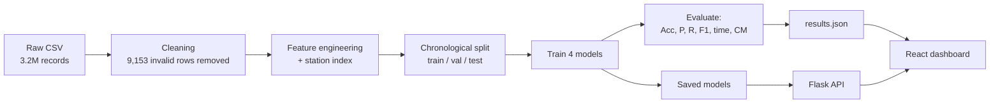

# 🌡️ Weather Anomaly Classifier

**A comparative deep-learning study (ANN · Deep Residual ANN · CNN-1D · GRU) with an interactive React dashboard**


Classifies daily weather-station records into four temperature-anomaly classes (**Strong Cold, Weak Cold, Weak Hot, Strong Hot**) and compares four deep-learning models on **Accuracy, Precision, Recall, F1-score, Training Time and Confusion Matrix**. All results are explored in a React dashboard.

> Individual PBL project, *Deep Learning (CSE0711)*, B.Tech CSE, ITM University, Gwalior.

---

## ✨ Highlights

- **3.2 million records, 2,716 U.S. weather stations, 1964–2013**, cleaned and prepared with a reproducible pipeline.
- **Four deep-learning models** with identical inputs, so differences come from the architecture only: ANN, Deep Residual ANN, CNN-1D, GRU.
- **Leakage-aware design:** the column `degrees_from_mean` defines the label, so it is **not** used as an input.
- **Time-ordered evaluation:** train 1964–2005, validation 2006–2009, test 2010–2013 (no random shuffling across years).
- **Imbalance handled** with square-root class weights; models compared with macro-averaged metrics.
- **Learned station embeddings** let each model learn station-specific climate behaviour.
- **React dashboard** with model comparison, confusion matrices, training curves and a live **Predict** tab (Flask API).
- **Works without installing Node.js:** a prebuilt `standalone/dashboard.html` opens in any browser.

## 🖼️ Screenshots

| Overview | Model comparison |
|---|---|
|  |  |

| Confusion matrix | Training curves |
|---|---|
|  |  |

| Predict tab |
|---|
|  |

## 📊 Results (preliminary run)

Measured on the **complete test set (266,173 records, 2010–2013)**. This run used **3 epochs** and **100,000 training rows** to verify the whole pipeline quickly; a full run is expected to improve all numbers. Precision, recall and F1 are **macro averages**.

| Model | Accuracy | Precision | Recall | F1-score | Training time | Parameters |
|---|---|---|---|---|---|---|
| ANN | 0.821 | 0.665 | **0.734** | 0.688 | **5.4 s** | 34,380 |
| **Deep Residual ANN** | **0.868** | **0.733** | 0.713 | **0.718** | 17.4 s | 126,572 |
| CNN-1D | 0.816 | 0.663 | 0.637 | 0.629 | 15.1 s | 32,492 |
| GRU | 0.719 | 0.517 | 0.524 | 0.481 | 32.4 s | 30,780 |

**Key findings**

- The **Deep Residual ANN** has the best macro F1-score (0.718) and accuracy (86.8%).
- The plain **ANN** is the fastest and has the best macro recall.
- The **GRU** is slowest and weakest: the inputs are not a real time series.
- For the ANN, the **hot-versus-cold direction was correct for about 98.6%** of test records; most errors are about whether an anomaly is *weak* or *strong* (for example Strong Hot predicted as Weak Hot).
- Validation loss was still falling for every model after 3 epochs, so results are preliminary.

## 🧠 Models

All models share one input block: 8 standardised numeric features + a station embedding (8 values) → a 16-value vector.

| Model | Body |
|---|---|
| ANN | Dense 128 → 64 → 32 (ReLU) with dropout |
| Deep Residual ANN | Dense 128, then 3 residual blocks (Dense → BatchNorm → ReLU → Dense → BatchNorm + skip) |
| CNN-1D | Conv1D 32 → Conv1D 64 → global max pooling → Dense 64 |
| GRU | GRU 48 → Dense 32 |

Training: Adam (lr 0.001), sparse categorical cross-entropy with class weights, early stopping, batch size 1,024.

## 🔄 How it works



## 📁 Project structure

```
WeatherAnomaly-DL/
├── README.md
├── requirements.txt
├── .gitignore
├── train.py                  # trains + evaluates all models, writes results.json
├── api.py                    # Flask API for the Predict tab (/health, /predict)
├── backend/
│   ├── config.py             # paths, classes, split years, model list
│   ├── prepare_data.py       # load, clean, features, chronological split, scaling
│   ├── models.py             # ANN, Deep Residual ANN, CNN-1D, GRU
│   ├── metrics.py            # metrics, confusion matrix, results export, figures
│   └── artifacts/            # trained models, scaler (created by train.py)
├── frontend/                 # React + Vite dashboard
│   ├── package.json
│   ├── index.html
│   ├── public/results.json   # produced by train.py
│   └── src/                  # App.jsx, tabs.jsx, charts.jsx, styles.css
├── standalone/
│   └── dashboard.html        # prebuilt dashboard (no Node.js needed)
├── data/                     # put the dataset CSV here (not tracked by git)
├── report_figures/           # figures produced by train.py
├── notebooks/
│   └── Colab_Train_WeatherAnomaly.ipynb   # one-click training on Google Colab
└── docs/
    ├── screenshots/          # images used in this README
    └── PBL_Report.pdf        # full project report
```

## 🚀 Getting started

### 1. Get the code and the dataset

```bash
git clone https://github.com/<your-username>/WeatherAnomaly-DL.git
cd WeatherAnomaly-DL
```

The dataset **`weather-anomalies-1964-2013.csv`** is large, so it is **not stored in this repository**. Place it at:

```
data/weather-anomalies-1964-2013.csv
```

### 2. Train the models

**Option A: Google Colab (recommended, free GPU, nothing to install)**
Open `notebooks/Colab_Train_WeatherAnomaly.ipynb` in [Google Colab](https://colab.research.google.com), set *Runtime → T4 GPU* and run the cells in order.

**Option B: your own computer** (TensorFlow needs Python 3.10–3.12)

```bash
python -m venv .venv
# Windows:  .venv\Scripts\activate        macOS/Linux:  source .venv/bin/activate
python -m pip install -r requirements.txt

python train.py --epochs 3 --max-train 100000   # quick test
python train.py                                  # full run
```

Useful options: `--epochs`, `--max-train`, `--max-val`, `--batch`, `--models ann dnn cnn gru`, `--csv path/to/file.csv`.
`train.py` writes `frontend/public/results.json`, models in `backend/artifacts/` and figures in `report_figures/`.

### 3. Open the dashboard

**No installation:** open `standalone/dashboard.html` in a browser, click **Load results.json** and choose `frontend/public/results.json`.

**React development setup** (Node.js 18+):

```bash
cd frontend
npm install
npm run dev          # opens http://localhost:5173 and loads results.json automatically
```

### 4. (Optional) Live predictions

```bash
python api.py        # starts the Flask API on http://localhost:5000
```

Then use the **Predict** tab. It needs the trained models in `backend/artifacts/`.

## 🖥️ Dashboard tabs

| Tab | What it shows |
|---|---|
| Overview | Dataset summary, chronological split, class distribution, method notes |
| Model comparison | Accuracy, precision, recall, F1-score, training time, parameters, inference time (macro or weighted) |
| Confusion matrix | Per-model matrix (% or counts) and per-class precision/recall/F1 |
| Training curves | Loss or accuracy per epoch for all models |
| Predict | Classifies a day from temperatures, location and date; shows class probabilities |

## 🧪 Data and method notes

- **Dataset:** daily U.S. station records, 1964–2013; **9,153 invalid rows** (for example minimum above maximum temperature) removed, leaving 3,187,679.
- **Features:** max/min temperature, range, mean, latitude, longitude, sine/cosine of day-of-year, plus a learned station embedding.
- **Why `degrees_from_mean` is excluded:** the class label is derived from it. In a quick check with a gradient-boosting classifier on a 300k-row sample, accuracy was about 99.6% with the column and about 90% without, so using it would be data leakage.
- **Distribution shift:** hot classes are 53.2% of the training sample but 69.9% of the test years, so the models must generalise to a different class mix.

## ⚠️ Limitations

- Preliminary results: 3 epochs, 100k training rows, a single random seed.
- U.S. stations only (1964–2013); predictions for other regions are only an interface demonstration.
- No non-neural baseline (for example gradient-boosted trees) was trained.
- Research and classroom prototype, **not** an official weather warning system.

## 🔭 Future work

- Full-data training, hyper-parameter tuning and multiple seeds with confidence intervals.
- Comparison with tree ensembles and tabular transformers.
- Use previous days' temperatures and station normals so that LSTM/temporal models get real sequences.
- Ordinal classification or focal loss for the weak/strong boundary; per-class thresholds.
- Explainability (SHAP) and cloud deployment of the API and dashboard.

## 📄 Documentation

The full PBL report (literature review, methodology, results and discussion) is in [`docs/PBL_Report.pdf`](docs/PBL_Report.pdf).

## 👤 Author

**Himanshu Singh**: B.Tech CSE (4th year), ITM University, Gwalior (session 2023–2027)
Guide: **Dr. Pallavi Khatri**, Assistant Professor, SOET

## 🙏 Acknowledgements

TensorFlow/Keras, scikit-learn, pandas, NumPy, React, Vite and Flask. Station identifiers follow the GHCN-Daily convention.

## 📜 License

Developed for academic purposes. Add a `LICENSE` file (for example MIT) if you want others to reuse the code.
